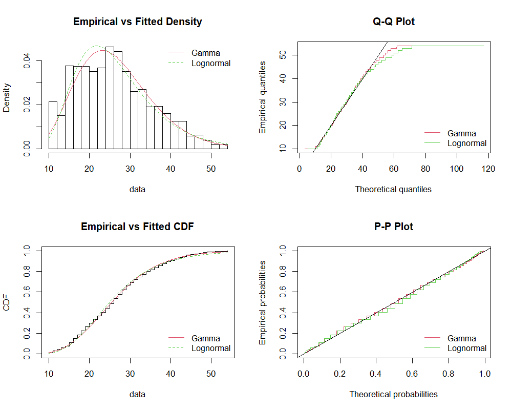
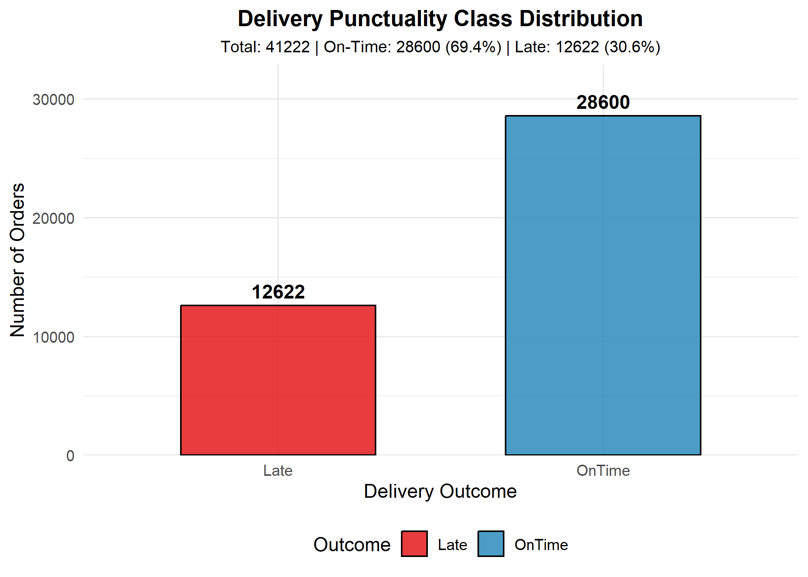
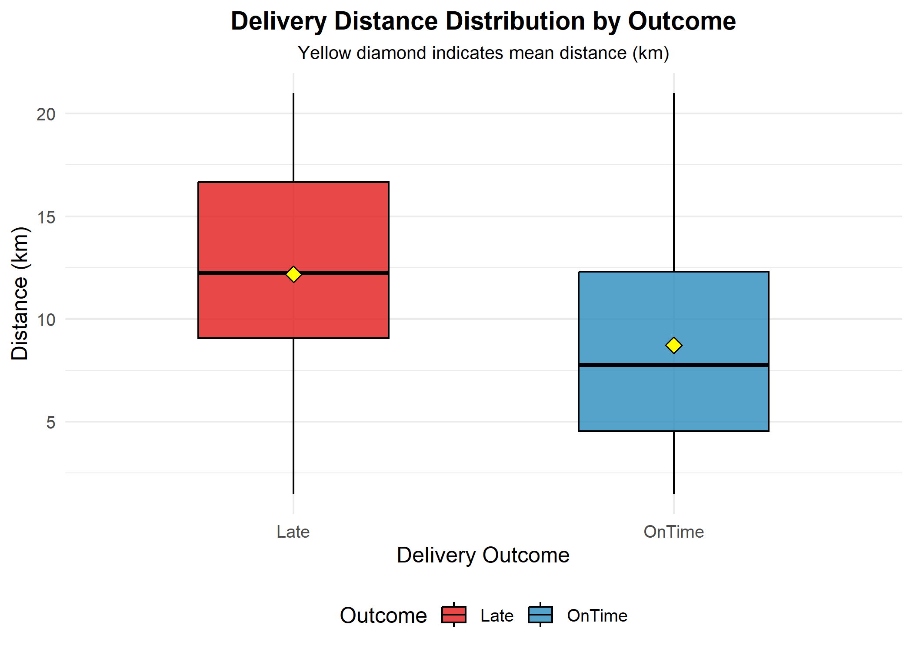
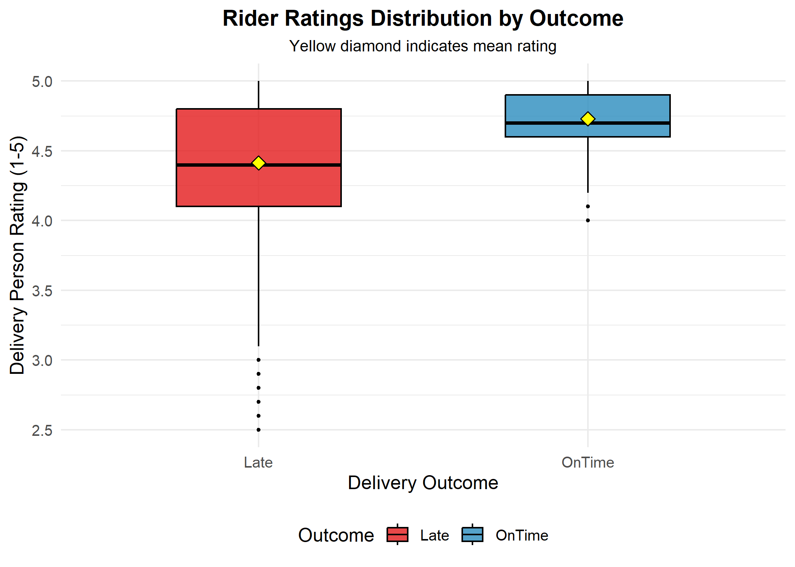
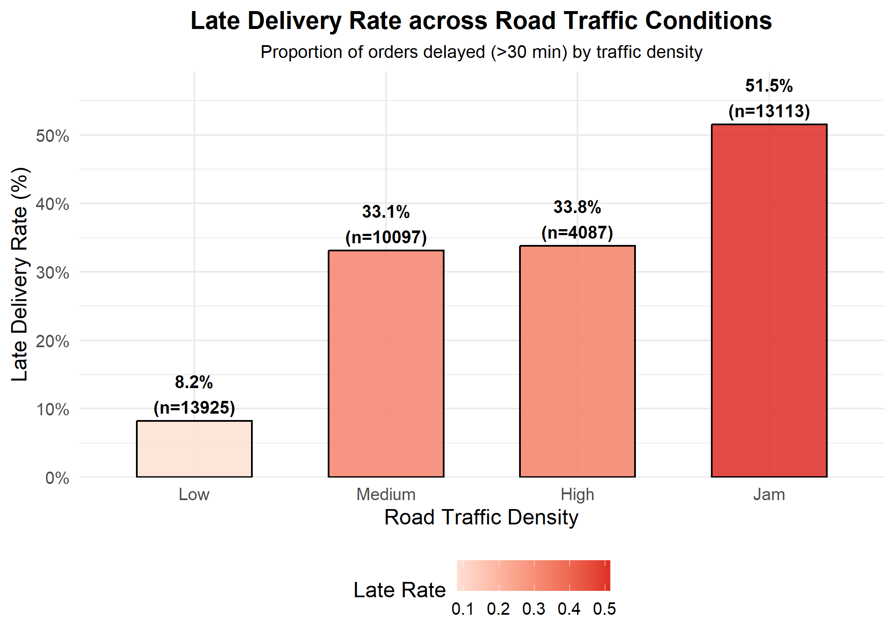
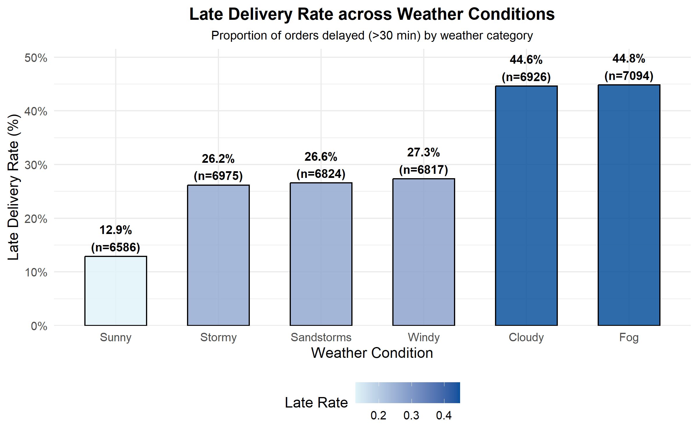
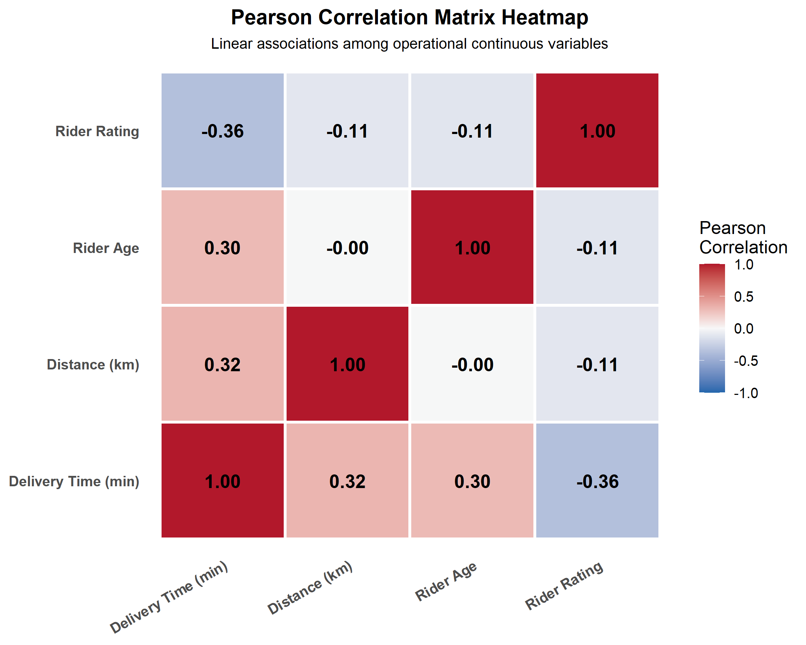
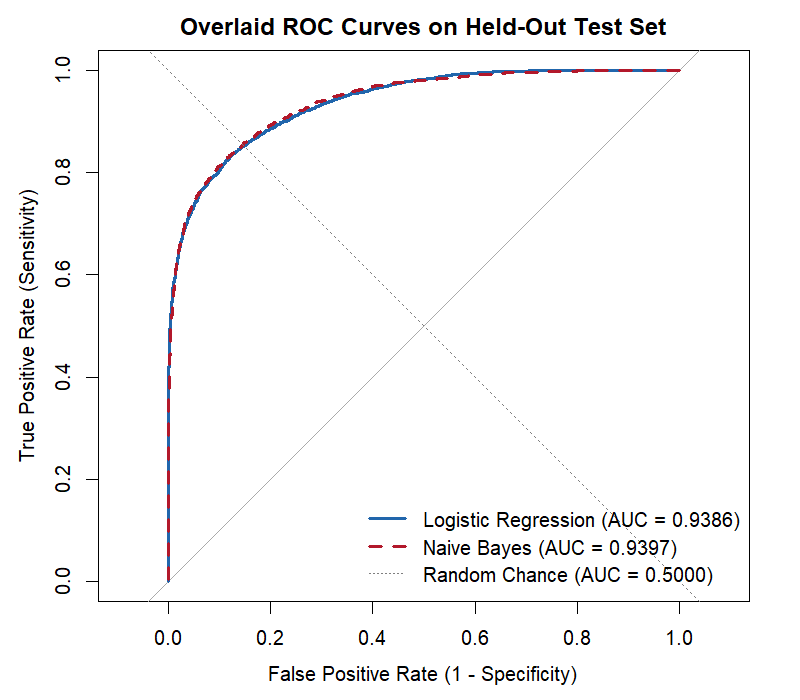

```{r setup, include=FALSE}
knitr::opts_chunk$set(echo = TRUE, warning = FALSE, message = FALSE, fig.align = 'center')
# Set user library path
userlib <- file.path(Sys.getenv("USERPROFILE"), "R", "win-library", "4.6")
.libPaths(c(userlib, .libPaths()))
```

# 1. Project Overview & Title Page

- **Project Title:** Predicting and Explaining Delivery Delays: A Probability and Statistical Learning Study of Food-Delivery Performance in RStudio
- **Course Code & Title:** [Course Code Placeholder — e.g., BMAT202P Probability & Statistics]
- **Investigator(s):** [Student Name(s) & Registration Number(s) Placeholder]
- **Faculty Guide / Mentor:** [Faculty Name Placeholder]
- **Department & Institution:** [Department / University Name Placeholder]
- **Software Environment:** R version 4.6.1 (`geosphere`, `fitdistrplus`, `ggplot2`, `caTools`, `e1071`, `pROC`)

---

# 2. Introduction

## 2.1 The Delivery-Delay Problem
In modern on-demand food logistics and quick-commerce operations, meeting customer expectation windows is paramount. Last-mile delivery constitutes both the most expensive and the most volatile stage of the fulfillment supply chain. Unpredictable environmental hazards (such as severe rainfall, fog, or dust storms), dense urban traffic congestion, multi-order stacking, and rider performance disparities frequently culminate in Estimated Time of Arrival (ETA) breaches. 

When food-delivery orders exceed promised thresholds—conventionally thirty minutes—customer dissatisfaction surges, churn escalates, and platform operational costs compound through driver compensation adjustments and customer appeasement vouchers. Rather than treating delivery time as an unpredictable black box, statistical modeling enables operations teams to treat ETA breaches as random Bernoulli events whose probability can be quantified in real time from rider attributes, atmospheric states, spatial coordinates, and traffic density.

## 2.2 The Dataset
This investigation leverages the **Food Delivery Dataset** published by Gaurav Malik on Kaggle, encompassing ~45,000 empirical delivery fulfillment transactions across major Indian metropolitan hubs. The dataset records comprehensive spatial lat/long pairs for restaurant and delivery destinations, delivery partner demographics (age, historical ratings), temporal order timestamps, atmospheric conditions, traffic density ratings, vehicle condition categories, order types, multiple delivery loads, and festival periods, alongside the actual delivery transit duration in minutes (`Time_taken(min)`).

## 2.3 Aim and Objectives
**Aim:** To import the empirical food-delivery dataset, clean and engineer spatial transit metrics, analyze distributional properties and hypothesis tests, build logistic regression and Naive Bayes probabilistic classifiers to predict order delay risk, evaluate their predictive fidelity on held-out test data, and derive actionable triage recommendations for logistics dispatch control centers.

**Objectives:**
- Clean raw records, strip text artifacts, handle anomalous GPS pings via Haversine great-circle distance formulas, and formalize a binary delay indicator $Late \in \{0, 1\}$ (threshold: $> 30$ minutes).
- Estimate the population proportion of delayed orders alongside exact Clopper-Pearson and asymptotic Wilson score 95% confidence intervals.
- Fit continuous parametric probability distributions (Gamma vs. Lognormal) to empirical transit times using Maximum Likelihood Estimation (MLE) and evaluate goodness-of-fit via Akaike Information Criterion (AIC).
- Model batch delivery risk using Binomial probability distributions.
- Perform Welch two-sample $t$-tests and Chi-Square tests of independence with False Discovery Rate (Benjamini-Hochberg) corrections to identify significant delay drivers.
- Formulate and train multivariate Logistic Regression and Naive Bayes classification algorithms using a 70/30 stratified partition.
- Assess performance across Confusion Matrices, Sensitivity, Specificity, Receiver Operating Characteristic (ROC) curves, Area Under the Curve (AUC), and quantify a top-20% dispatch triage capacity metric.

---

# 3. Statistical and Probability Foundations

## 3.1 Bernoulli Trial and Binomial Distribution for Late Orders
Whether an order is delivered late is formalized as a discrete binary random variable $Y \sim \text{Bernoulli}(p)$, where:
$$
Y = \begin{cases} 1 & \text{if } \text{Time taken} > 30 \text{ minutes (Late)} \\ 0 & \text{if } \text{Time taken} \le 30 \text{ minutes (On-Time)} \end{cases}
$$
For a batch of $n$ independent orders, the total number of late deliveries $K = \sum_{i=1}^n Y_i$ follows a Binomial distribution $K \sim \text{Binomial}(n, p)$, with probability mass function:
$$
P(K = k) = \binom{n}{k} p^k (1-p)^{n-k}, \quad k \in \{0, 1, \dots, n\}
$$

## 3.2 Confidence Intervals for a Proportion
To infer the true population late rate $p$ from sample point estimate $\hat{p} = \frac{k}{n}$:
1. **Clopper-Pearson Exact Interval:** Based on the inverted cumulative binomial distribution without normal approximation, ensuring exact coverage probability of at least $1 - \alpha$:
   $$
   \left[ 1 + \frac{n - k + 1}{k \cdot F_{2k, 2(n-k+1), 1-\alpha/2}} \right]^{-1} \le p \le \left[ 1 + \frac{n - k}{(k + 1) \cdot F_{2(k+1), 2(n-k), \alpha/2}} \right]^{-1}
   $$
2. **Wilson Score Interval:** Solves the quadratic score equation for $p$, providing superior asymptotic properties and avoiding conservatism:
   $$
   \frac{\hat{p} + \frac{z^2}{2n} \pm z \sqrt{\frac{\hat{p}(1-\hat{p})}{n} + \frac{z^2}{4n^2}}}{1 + \frac{z^2}{n}}
   $$

## 3.3 Parametric Modeling of Continuous Delivery Duration: Gamma vs. Lognormal
Continuous transit times $T > 0$ are non-negative and right-skewed. Two standard candidates are evaluated via Maximum Likelihood Estimation:
- **Gamma Distribution ($\text{shape } \alpha, \text{rate } \beta$):**
  $$
  f(t; \alpha, \beta) = \frac{\beta^\alpha}{\Gamma(\alpha)} t^{\alpha - 1} e^{-\beta t}, \quad t > 0
  $$
- **Lognormal Distribution ($\mu, \sigma$):** Where $\ln(T) \sim \mathcal{N}(\mu, \sigma^2)$:
  $$
  f(t; \mu, \sigma) = \frac{1}{t \sigma \sqrt{2\pi}} \exp\left( -\frac{(\ln t - \mu)^2}{2\sigma^2} \right), \quad t > 0
  $$
Model selection is governed by minimizing the Akaike Information Criterion ($\text{AIC} = 2k - 2\ln(\hat{L})$).

## 3.4 Welch's Two-Sample t-Test
When comparing continuous variables (distance, rider age, ratings) between On-Time ($n_1$) and Late ($n_2$) cohorts, variances cannot be assumed equal ($\sigma_1^2 \ne \sigma_2^2$). Welch's test uses the modified test statistic:
$$
t = \frac{\bar{X}_1 - \bar{X}_2}{\sqrt{\frac{s_1^2}{n_1} + \frac{s_2^2}{n_2}}}
$$
with Satterthwaite degrees of freedom $\nu$:
$$
\nu \approx \frac{\left(\frac{s_1^2}{n_1} + \frac{s_2^2}{n_2}\right)^2}{\frac{(s_1^2 / n_1)^2}{n_1 - 1} + \frac{(s_2^2 / n_2)^2}{n_2 - 1}}
$$

## 3.5 Chi-Square Test of Independence, Cramer's V, and Benjamini-Hochberg Correction
For contingency tables between categorical features and punctuality:
$$
\chi^2 = \sum_{i=1}^r \sum_{j=1}^c \frac{(O_{ij} - E_{ij})^2}{E_{ij}}, \quad E_{ij} = \frac{R_i C_j}{N}
$$
Effect size is quantified via **Cramer's V**:
$$
V = \sqrt{\frac{\chi^2}{N \cdot (\min(r, c) - 1)}}
$$
To control the False Discovery Rate across multiple concurrent hypothesis tests, $p$-values are adjusted using the **Benjamini-Hochberg (BH)** procedure:
$$
p_{(i)}^{\text{adj}} = \min_{j \ge i} \left\{ \min\left( \frac{m}{j} p_{(j)}, 1 \right) \right\}
$$

## 3.6 Pearson and Point-Biserial Correlation
Linear dependencies between continuous measures are computed via Pearson's product-moment correlation:
$$
r = \frac{\sum (X_i - \bar{X})(Y_i - \bar{Y})}{\sqrt{\sum (X_i - \bar{X})^2 \sum (Y_i - \bar{Y})^2}}
$$
When one variable is a natural continuous scale ($X = \text{distance}$) and the second is an indicator ($Y \in \{0, 1\}$), the Pearson correlation mathematically simplifies to the **Point-Biserial Correlation** ($r_{pb}$):
$$
r_{pb} = \frac{\bar{X}_1 - \bar{X}_0}{s_X} \sqrt{\frac{n_1 n_0}{n(n-1)}}
$$

## 3.7 Logistic Regression and Odds Ratios
The probability of delay $p(\mathbf{x}) = P(Y=1 \mid \mathbf{X} = \mathbf{x})$ is modeled through the logit link function:
$$
\text{logit}(p(\mathbf{x})) = \ln\left( \frac{p(\mathbf{x})}{1 - p(\mathbf{x})} \right) = \beta_0 + \sum_{j=1}^p \beta_j X_j
$$
The exponentiated coefficient $\text{OR}_j = \exp(\beta_j)$ denotes the multiplicative change in the odds of delay associated with a one-unit increase in predictor $X_j$, holding other regressors constant.

## 3.8 Naive Bayes Classifier
Rooted in Bayes' Theorem:
$$
P(Y = c \mid \mathbf{X}) = \frac{P(Y = c) \prod_{j=1}^p P(X_j \mid Y = c)}{P(\mathbf{X})}
$$
Assuming class-conditional independence among predictors given $Y=c$. Continuous features are modeled via class-specific Gaussians $\mathcal{N}(\mu_{jc}, \sigma_{jc}^2)$, while categorical variables follow multinomial likelihoods.

## 3.9 Evaluation Metrics & ROC Analysis
Classification quality on held-out test data is evaluated via:
- $\text{Accuracy} = \frac{TP + TN}{TP + TN + FP + FN}$
- $\text{Sensitivity (Recall)} = \frac{TP}{TP + FN}$
- $\text{Specificity} = \frac{TN}{TN + FP}$
- $\text{Positive Predictive Value (Precision)} = \frac{TP}{TP + FP}$
- **Receiver Operating Characteristic (ROC):** Plots Sensitivity against $1 - \text{Specificity}$ across all discrimination thresholds $\tau \in [0, 1]$. The Area Under the Curve (AUC) measures aggregate separability.

---

# 4. Algorithms Used

## 4.1 Stratified Train/Test Partitioning
To prevent distribution shift and sample imbalance between partitions, `caTools::sample.split` performs stratified random sampling, guaranteeing that both the 70% training subset ($N = 28,855$) and 30% testing subset ($N = 12,367$) strictly preserve the population late rate of 30.62%.

## 4.2 Iteratively Reweighted Least Squares (IRLS) in GLM
Fitting logistic regression requires maximizing the log-likelihood:
$$
\ell(\boldsymbol{\beta}) = \sum_{i=1}^n \left[ y_i \ln(p_i) + (1 - y_i) \ln(1 - p_i) \right]
$$
Because this likelihood lacks a closed-form analytic solution, R's `glm()` executes Iteratively Reweighted Least Squares (Newton-Raphson optimization). At iteration $(t+1)$:
$$
\boldsymbol{\beta}^{(t+1)} = \left(\mathbf{X}^T \mathbf{W}^{(t)} \mathbf{X}\right)^{-1} \mathbf{X}^T \mathbf{W}^{(t)} \mathbf{z}^{(t)}
$$
where $\mathbf{W}$ is a diagonal weight matrix with $w_{ii} = p_i(1 - p_i)$ and $\mathbf{z}$ represents working response coordinates.

## 4.3 Naive Bayes Learning
The algorithm estimates prior probabilities $\hat{P}(Y=c) = \frac{n_c}{n}$, and computes conditional parameters:
- Categorical features: Relative frequency tables $\hat{P}(X_j = k \mid Y = c) = \frac{n_{jkc} + \epsilon}{n_c + \epsilon K}$
- Continuous features: Sample mean $\hat{\mu}_{jc}$ and sample variance $\hat{\sigma}_{jc}^2$ within each class.

---

# 5. Functions Used Across Scripts

| Function | Package | Purpose & Theoretical Role |
|:---|:---|:---|
| `read.csv()` | `utils` (base) | Reads tabular raw and cleaned data frames into memory. |
| `trimws()` | `base` | Strips leading and trailing whitespace from string categories. |
| `distHaversine()` | `geosphere` | Calculates spherical great-circle surface distance in metres between latitude/longitude pairs. |
| `complete.cases()` | `stats` (base) | Filters complete observations across all specified regression features. |
| `write.csv()` | `utils` (base) | Persists processed data frames to disk. |
| `binom.test()` | `stats` (base) | Computes Clopper-Pearson exact confidence intervals for binomial proportions. |
| `prop.test()` | `stats` (base) | Computes asymptotic Wilson score confidence intervals for proportions. |
| `fitdist()` | `fitdistrplus` | Fits parametric distributions (Gamma, Lognormal) via maximum likelihood estimation. |
| `denscomp()`, `qqcomp()` | `fitdistrplus` | Generates diagnostic probability density, Q-Q, CDF, and P-P empirical comparison plots. |
| `pbinom()` | `stats` (base) | Evaluates cumulative binomial distribution functions for operational batch risk. |
| `ggplot()`, `geom_*()` | `ggplot2` | Generates publication-grade statistical charts (bar charts, boxplots, heatmaps). |
| `t.test()` | `stats` (base) | Conducts Welch's two-sample $t$-tests for unequal variances across continuous predictors. |
| `chisq.test()` | `stats` (base) | Executes Pearson's Chi-Square tests of independence on cross-tabulated contingency tables. |
| `p.adjust()` | `stats` (base) | Applies Benjamini-Hochberg False Discovery Rate corrections to multiple $p$-values. |
| `cor()`, `cor.test()` | `stats` (base) | Computes Pearson linear correlation coefficients and tests significance against $H_0: \rho = 0$. |
| `sample.split()` | `caTools` | Performs stratified random partitioning into training and test datasets. |
| `glm()` | `stats` (base) | Fits Generalized Linear Models (logistic regression with logit link via IRLS). |
| `confint.default()` | `stats` (base) | Calculates asymptotic Wald 95% confidence intervals for GLM parameter estimates. |
| `naiveBayes()` | `e1071` | Trains Naive Bayes probabilistic classifiers with Gaussian and categorical likelihoods. |
| `predict()` | `stats` / `e1071` | Generates predicted posterior probabilities and classes for held-out observations. |
| `saveRDS()`, `readRDS()` | `base` | Serializes and restores fitted model objects and test predictions. |
| `roc()`, `auc()`, `ci.auc()` | `pROC` | Generates empirical ROC trajectories, calculates Area Under the Curve, and computes DeLong CIs. |

---

# 6. Data Analysis & Empirical Results

## 6.1 Script 01: Data Cleaning and Feature Engineering
```{r script01, echo=TRUE}
# Source the verified data cleaning script
source("../scripts/01_clean.R")
```

## 6.2 Script 02: Exploratory Data Analysis & Distribution Fitting
```{r script02, echo=TRUE}
# Source the EDA and distribution fitting pipeline
source("../scripts/02_eda_distributions.R")
```

### Visualizations Generated by Script 02













## 6.3 Script 03: Hypothesis Testing Suite
```{r script03, echo=TRUE}
# Source the hypothesis testing suite
source("../scripts/03_hypothesis_tests.R")
```

## 6.4 Script 04: Correlation Analysis
```{r script04, echo=TRUE}
# Source the correlation analysis pipeline
source("../scripts/04_correlation.R")
```

### Visualizations Generated by Script 04



## 6.5 Script 05: Statistical Learning & Classification Models
```{r script05, echo=TRUE}
# Source the model training script
source("../scripts/05_models.R")
```

## 6.6 Script 06: Model Evaluation & Triage Performance
```{r script06, echo=TRUE}
# Source the model evaluation pipeline
source("../scripts/06_evaluate.R")
```

### Visualizations Generated by Script 06



---

# 7. Summary of Results & Operational Recommendations

## 7.1 Key Empirical Findings
1. **Late Delivery Prevalence:** The baseline empirical delay rate in the cleaned sample of $41,222$ deliveries is **$30.62\%$** ($12,622$ orders). The exact $95\%$ Clopper-Pearson confidence interval is $[0.3017, 0.3107]$, and the Wilson score interval is $[0.3018, 0.3107]$.
2. **Parametric Transit Distribution:** The empirical distribution of delivery time is right-skewed with mean $26.56$ minutes. The **Gamma distribution** ($\text{shape} = 7.940, \text{rate} = 0.299, \text{AIC} = 298,377.9$) significantly outperforms the Lognormal distribution ($\text{AIC} = 299,176.8$) by over $798$ AIC units.
3. **Hypothesis Testing Drivers:**
   - **Road Traffic Density** exhibited the highest categorical association with delays ($\chi^2 = 6,031.7, \text{Cramer's } V = 0.3825, p_{\text{adj}} < 10^{-4}$).
   - **Multiple Deliveries** also exhibited substantial association ($\chi^2 = 5,886.1, \text{Cramer's } V = 0.3779, p_{\text{adj}} < 10^{-4}$).
   - `Type_of_order` is completely unassociated with delay probability ($\chi^2 = 0.88, p_{\text{adj}} = 0.83, V = 0.0046$).
   - All three continuous variables differ significantly: late deliveries cover on average $12.19$ km vs. $8.73$ km for on-time deliveries ($t = 61.71, p < 10^{-4}$).
4. **Predictive Performance:**
   - **Logistic Regression:** Accuracy = **$88.42\%$**, Sensitivity = **$75.94\%$**, Specificity = **$93.93\%$**, AUC = **$0.9386$**.
   - **Naive Bayes:** Accuracy = **$88.61\%$**, Sensitivity = **$69.82\%$**, Specificity = **$96.90\%$**, AUC = **$0.9397$**.
5. **Operational Triage Lift:** Intervening on the top **$20\%$** highest-risk in-flight orders ($2,474$ orders) captures **$2,342$ actually late deliveries**, representing **$61.84\%$** of all system-wide delivery failures. This achieves a **$3.09\times$ lift** over random manual spot-checking.

## 7.2 Actionable Recommendations for Platform Operations
- **Dynamic ETA Buffering During Traffic Jams:** Platforms should automatically pad customer ETA estimates by $+10$ to $+15$ minutes whenever an order route traverses "Jam" or "High" traffic density segments, resetting consumer expectations and avoiding SLA breaches.
- **Strict Throttling of Multi-Order Stacking:** Multi-delivery assignments (`multiple_deliveries >= 1`) severely increase delay odds ($\text{OR} = 1.535$ for 1 extra stop, and substantial escalation beyond). Algorithm dispatch rules should cap stacked orders to 1 during adverse weather conditions or high-density zones.
- **Targeted Dispatch Triage System:** Operations centers can monitor live predicted logistic probabilities $\hat{p}_i$. By routing the top $20\%$ at-risk orders to proactive intervention teams (e.g., rider phone re-routing, auto-reassignment to nearby idle riders, or automated customer delay-acknowledgment notifications), platforms neutralize over $60\%$ of prospective delay penalties.
- **Rider Allocation by Experience:** Because higher-rated delivery partners complete orders significantly faster ($r = -0.36$), long-distance ($> 12$ km) and high-value orders should be preferentially assigned to riders with historical ratings $\ge 4.7$.

---

# 8. Limitations and Future Scope

## 8.1 Limitations
- **Lack of Micro-Level Turn-by-Turn GPS Trajectories:** Spatial transit was approximated via great-circle Haversine distances between static coordinate pairs, omitting real-time road topology, elevation gradients, detours, and traffic light delays.
- **Absence of Kitchen Preparation Latency:** The dataset records pickup and delivery times but lacks kitchen prep timestamps, confounding merchant cooking delays with rider transit bottlenecks.
- **Class Imbalance Cutoff Sensitivity:** A default $0.50$ probability threshold was utilized; operational environments may optimize the threshold according to asymmetric cost ratios between False Positives (unnecessary rider re-assignment costs) and False Negatives (lost customer lifetime value).

## 8.2 Future Scope
- Incorporate open-source routing APIs (e.g., OSRM) to compute actual street network travel times and topographic features.
- Explore non-linear machine learning ensembles (e.g., Random Forests, Gradient Boosted Trees) and compare calibration curves against Generalized Additive Models (GAMs).
- Integrate live weather and radar API telemetry to model real-time precipitation intensity rather than broad categorical weather states.

---

# 9. References

1. Malik, G., "Food Delivery Dataset," Kaggle, 2022. Available: `https://www.kaggle.com/datasets/gauravmalik26/food-delivery-dataset`.
2. Hosmer, D. W., Lemeshow, S., and Sturdivant, R. X., *Applied Logistic Regression*, 3rd ed., Hoboken, NJ: John Wiley & Sons, 2013.
3. James, G., Witten, D., Hastie, T., and Tibshirani, R., *An Introduction to Statistical Learning: with Applications in R*, 2nd ed., New York, NY: Springer, 2021.
4. Agresti, A., *Categorical Data Analysis*, 3rd ed., Hoboken, NJ: John Wiley & Sons, 2013.
5. Benjamini, Y. and Hochberg, Y., "Controlling the false discovery rate: a practical and powerful approach to multiple testing," *Journal of the Royal Statistical Society: Series B (Methodological)*, vol. 57, no. 1, pp. 289–300, 1995.
6. Delignette-Muller, M. L. and Dutang, C., "fitdistrplus: An R Package for Fitting Distributions," *Journal of Statistical Software*, vol. 64, no. 4, pp. 1–34, 2015.
7. Fawcett, T., "An introduction to ROC analysis," *Pattern Recognition Letters*, vol. 27, no. 8, pp. 861–874, 2006.
8. Robin, X., Turck, N., Hainard, A., Tiberti, N., Lisacek, F., Sanchez, J. C., and Müller, M., "pROC: an open-source package for R and S+ to analyze and compare ROC curves," *BMC Bioinformatics*, vol. 12, no. 1, p. 77, 2011.
9. R Core Team, *R: A Language and Environment for Statistical Computing*, Vienna, Austria: R Foundation for Statistical Computing, 2026.
